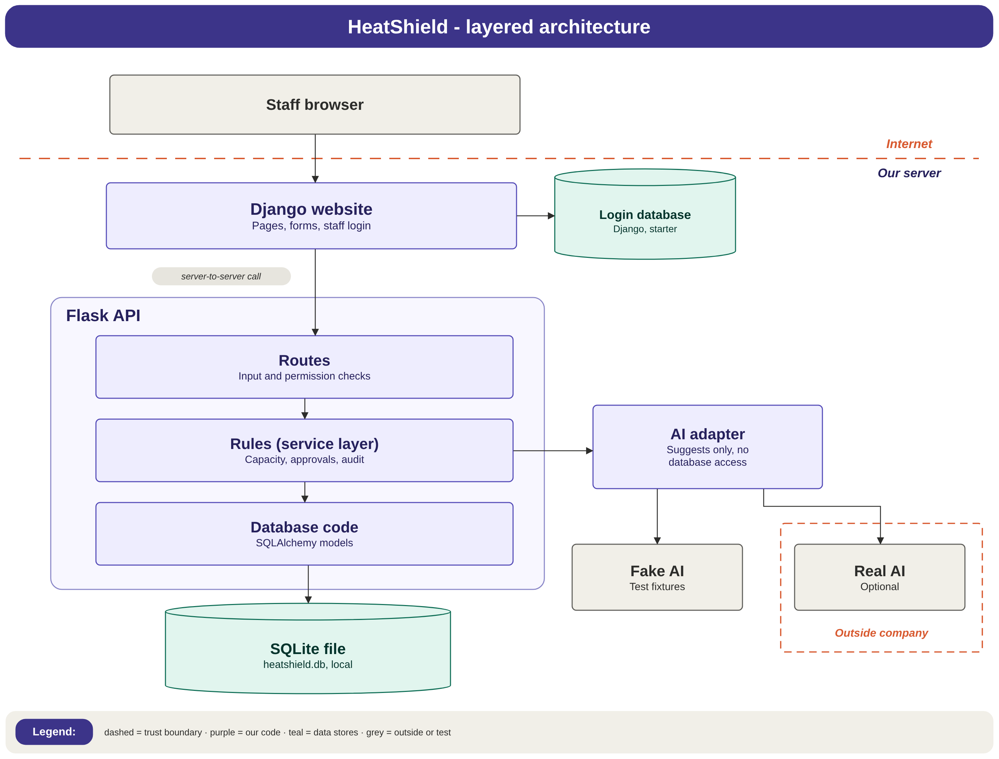

# HeatShield

Heatwave support coordination prototype for COM6402 Agile Programming (Group 9). It has a Flask REST API, a Django UI and a human-approved AI triage step. This is an educational prototype that uses fictional data only. It is not a diagnostic or emergency-response system.

- **Team:** Christos Dimitriou, Jay Zikhali, Saad Ashfaq
- **Design:** [`docs/design/`](docs/design) holds the architecture, the Flask API components and the ER diagrams. Edit `heatshield-design.drawio` in draw.io; the PNG files are exported from it.

## Status

This is the initial skeleton only: the folders, the app factory and its settings. The app starts but has no routes yet. The code needs Python 3.11 or newer.

## Where code goes

Each feature folder holds `routes.py`, `service.py`, `models.py` and `schemas.py`. `reports` has no `models.py` because its numbers are calculated, and `health` has only `routes.py`.

| Folder | What goes there |
|---|---|
| `api/app/requests/` | Support requests, residents, filters |
| `api/app/centres/` | Centres and bookings, with the capacity and closure rules |
| `api/app/areas/` | Area list for filters |
| `api/app/triage/` | AI suggestions: create, approve, edit, reject |
| `api/app/escalations/` | Emergency-language flags |
| `api/app/reports/` | Dashboard counts (calculated, not stored) |
| `api/app/audit/` | Who changed what, and when |
| `api/app/health/` | Health check and API docs |
| `api/app/common/` | Shared helpers: staff permissions (401/403) and JSON errors |
| `api/ai_adapter/` | AI adapter, outside the Flask app: a Fake version now, a Real one optionally |
| `api/migrations/` | Database migrations (Flask-Migrate) |
| `web/` | Django UI, from the tutor's starter project |
| `evaluation/` | AI evaluation runner and test cases |

## Ground rules from the design

- Business rules live only in each feature's `service.py`, and routes stay thin.
- Features call each other's service, never each other's routes or tables.
- The AI adapter only makes suggestions. It has no database access, and it is sent the request description only, never resident details.
- Use fictional data only.
- Add the tutor's starter project in one commit labelled as supplied code, so it stays separate from our own work.
